# Galerie

Beispielgrafiken mit `theme_bfh()` und den BFH-Farbskalen, alle mit
R-Standarddatensätzen. Unter jeder Grafik lässt sich der Code aufklappen.
Zurück zum [README](README.md).

## Balken

### Balken, eine Farbe

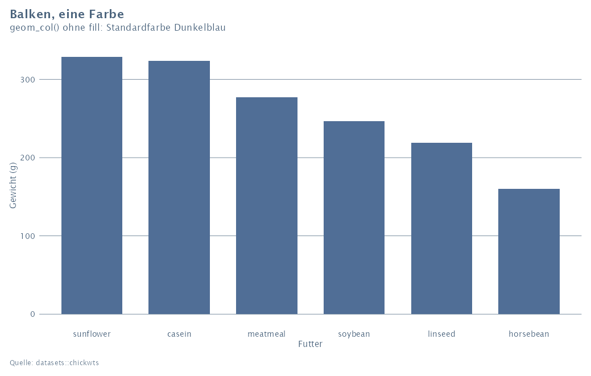

<details><summary>Code</summary>

```r
d <- aggregate(weight ~ feed, chickwts, mean)

ggplot(d, aes(reorder(feed, -weight), weight)) +
  geom_col(width = 0.7) +
  labs(title = "Balken, eine Farbe",
       subtitle = "geom_col() ohne fill: Standardfarbe Dunkelblau",
       x = "Futter", y = "Gewicht (g)", caption = "Quelle: datasets::chickwts") +
  theme_bfh()
```

</details>

### Gruppierte Balken


<details><summary>Code</summary>

```r
d <- aggregate(Freq ~ Hair + Eye, as.data.frame(HairEyeColor), sum)

ggplot(d, aes(Hair, Freq, fill = Eye)) +
  geom_col(position = position_dodge(width = 0.85), width = 0.8) +
  labs(title = "Gruppierte Balken",
       subtitle = "position_dodge(), Standardpalette ohne scale_fill_bfh()",
       x = "Haarfarbe", y = "Anzahl", fill = "Augenfarbe",
       caption = "Quelle: datasets::HairEyeColor") +
  theme_bfh()
```

</details>

### Gestapelte Anteile mit Beschriftung

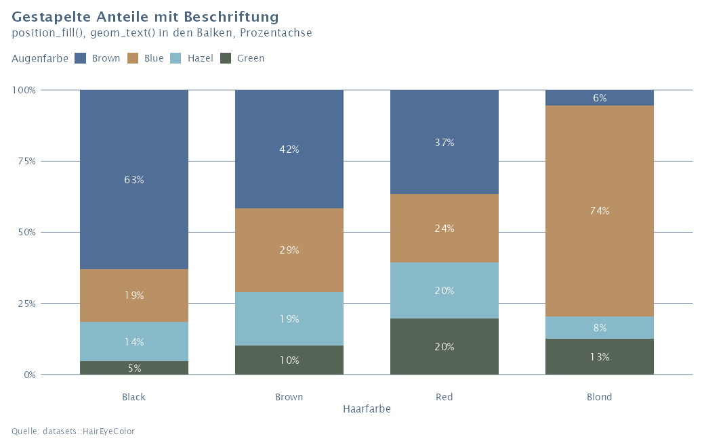

<details><summary>Code</summary>

```r
d <- aggregate(Freq ~ Hair + Eye, as.data.frame(HairEyeColor), sum)
d$anteil <- ave(d$Freq, d$Hair, FUN = function(x) x / sum(x))

ggplot(d, aes(Hair, Freq, fill = Eye)) +
  geom_col(position = "fill", width = 0.7) +
  geom_text(aes(label = scales::percent(anteil, accuracy = 1)),
            position = position_fill(vjust = 0.5), colour = "white", size = 3.2) +
  scale_y_continuous(labels = scales::percent) +
  labs(title = "Gestapelte Anteile mit Beschriftung",
       subtitle = "position_fill(), geom_text() in den Balken, Prozentachse",
       x = "Haarfarbe", y = NULL, fill = "Augenfarbe",
       caption = "Quelle: datasets::HairEyeColor") +
  theme_bfh()
```

</details>

### Horizontale Balken mit Werten

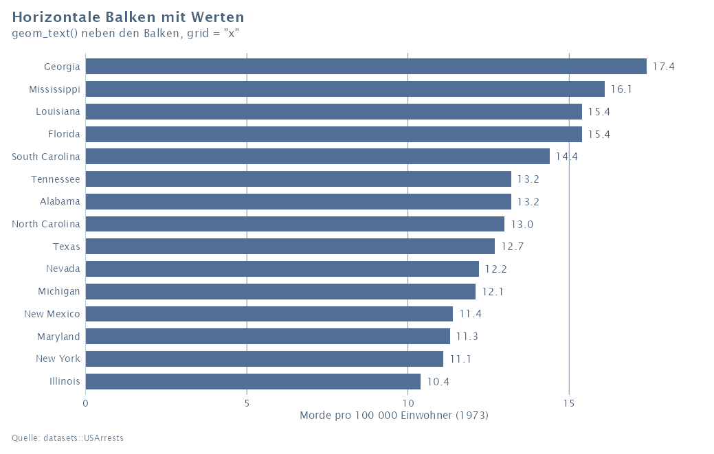

<details><summary>Code</summary>

```r
d <- head(USArrests[order(-USArrests$Murder), , drop = FALSE], 15)
d$state <- rownames(d)

ggplot(d, aes(Murder, reorder(state, Murder))) +
  geom_col(width = 0.7) +
  geom_text(aes(label = format(Murder, nsmall = 1)), hjust = -0.25, size = 3.2) +
  scale_x_continuous(expand = expansion(mult = c(0, 0.1))) +
  labs(title = "Horizontale Balken mit Werten",
       subtitle = "geom_text() neben den Balken, grid = \"x\"",
       x = "Morde pro 100 000 Einwohner (1973)", y = NULL,
       caption = "Quelle: datasets::USArrests") +
  theme_bfh(grid = "x")
```

</details>

### Highlight

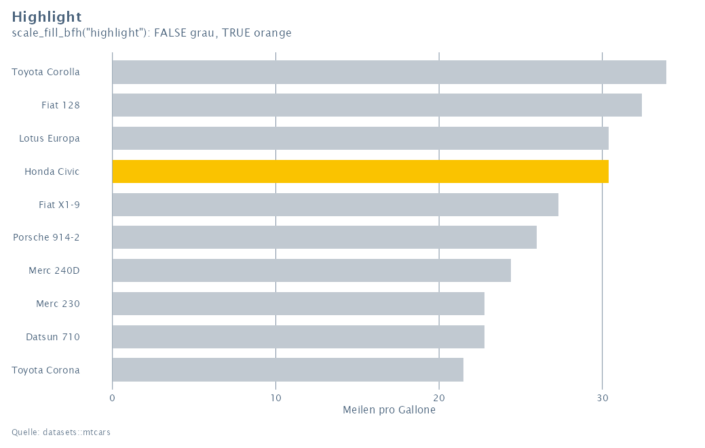

<details><summary>Code</summary>

```r
d <- head(mtcars[order(-mtcars$mpg), ], 10)
d$auto <- rownames(d)
d$fokus <- d$auto == "Honda Civic"

ggplot(d, aes(mpg, reorder(auto, mpg), fill = fokus)) +
  geom_col(width = 0.7) +
  scale_fill_bfh("highlight", guide = "none") +
  labs(title = "Highlight",
       subtitle = "scale_fill_bfh(\"highlight\"): FALSE grau, TRUE orange",
       x = "Meilen pro Gallone", y = NULL, caption = "Quelle: datasets::mtcars") +
  theme_bfh(grid = "x")
```

</details>

### Gestapelt, geordneter Faktor

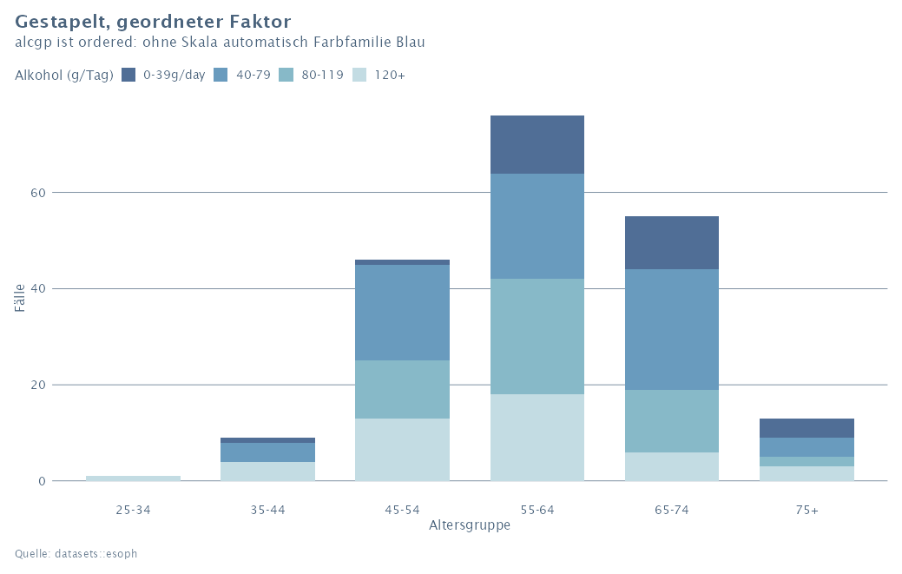

<details><summary>Code</summary>

```r
d <- aggregate(ncases ~ agegp + alcgp, esoph, sum)

ggplot(d, aes(agegp, ncases, fill = alcgp)) +
  geom_col(width = 0.7) +
  labs(title = "Gestapelt, geordneter Faktor",
       subtitle = "alcgp ist ordered: ohne Skala automatisch Farbfamilie Blau",
       x = "Altersgruppe", y = "Fälle", fill = "Alkohol (g/Tag)",
       caption = "Quelle: datasets::esoph") +
  theme_bfh()
```

</details>

### Farbfamilie mit 4 Stufen

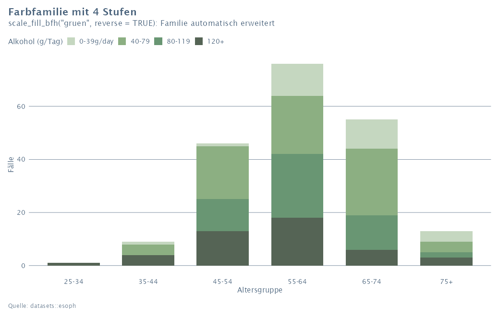

<details><summary>Code</summary>

```r
d <- aggregate(ncases ~ agegp + alcgp, esoph, sum)

ggplot(d, aes(agegp, ncases, fill = alcgp)) +
  geom_col(width = 0.7) +
  scale_fill_bfh("gruen", reverse = TRUE) +
  labs(title = "Farbfamilie mit 4 Stufen",
       subtitle = "scale_fill_bfh(\"gruen\", reverse = TRUE): Familie automatisch erweitert",
       x = "Altersgruppe", y = "Fälle", fill = "Alkohol (g/Tag)",
       caption = "Quelle: datasets::esoph") +
  theme_bfh()
```

</details>

## Linien und Zeitreihen

### Linien mit Punkten

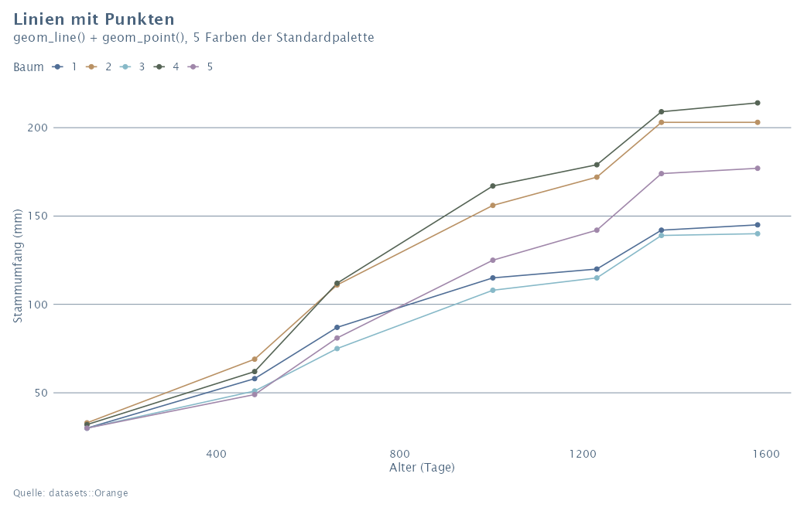

<details><summary>Code</summary>

```r
d <- Orange
d$Tree <- factor(as.character(d$Tree))

ggplot(d, aes(age, circumference, colour = Tree)) +
  geom_line() +
  geom_point() +
  labs(title = "Linien mit Punkten",
       subtitle = "geom_line() + geom_point(), 5 Farben der Standardpalette",
       x = "Alter (Tage)", y = "Stammumfang (mm)", colour = "Baum",
       caption = "Quelle: datasets::Orange") +
  theme_bfh()
```

</details>

### Direkte Beschriftung statt Legende


<details><summary>Code</summary>

```r
d <- aggregate(weight ~ Time + Diet, ChickWeight, mean)
ends <- d[d$Time == max(d$Time), ]

ggplot(d, aes(Time, weight, colour = Diet)) +
  geom_line() +
  geom_text(data = ends, aes(label = paste("Diät", Diet)),
            hjust = 0, nudge_x = 0.4, size = 3.4) +
  scale_x_continuous(expand = expansion(mult = c(0.02, 0.15))) +
  labs(title = "Direkte Beschriftung statt Legende",
       subtitle = "geom_text() am Linienende, legend_position = \"none\"",
       x = "Tage", y = "Mittleres Gewicht (g)",
       caption = "Quelle: datasets::ChickWeight") +
  theme_bfh(legend_position = "none")
```

</details>

### Zeitreihe mit Datumsachse

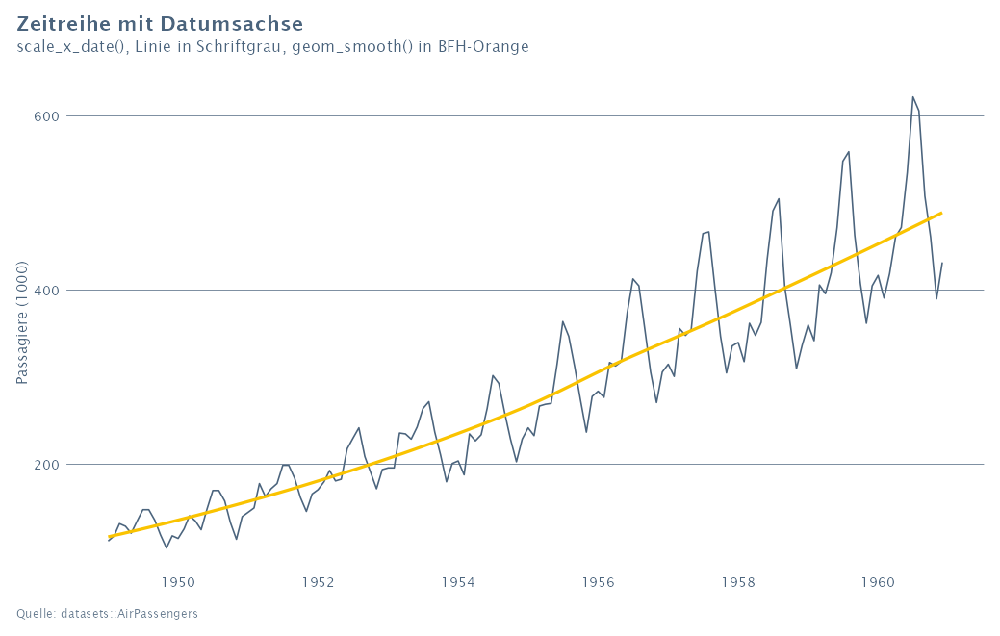

<details><summary>Code</summary>

```r
d <- data.frame(datum = seq(as.Date("1949-01-01"), by = "month", length.out = 144),
                passagiere = as.numeric(AirPassengers))

ggplot(d, aes(datum, passagiere)) +
  geom_line() +
  geom_smooth(method = "loess", formula = y ~ x, se = FALSE) +
  scale_x_date(date_breaks = "2 years", date_labels = "%Y") +
  labs(title = "Zeitreihe mit Datumsachse",
       subtitle = "scale_x_date(), Linie in Schriftgrau, geom_smooth() in BFH-Orange",
       x = NULL, y = "Passagiere (1000)", caption = "Quelle: datasets::AirPassengers") +
  theme_bfh()
```

</details>

### Annotationen und Referenzlinien

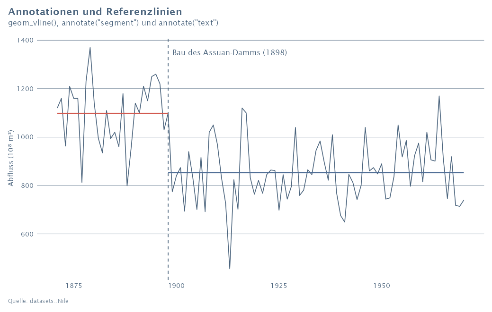

<details><summary>Code</summary>

```r
d <- data.frame(jahr = 1871:1970, abfluss = as.numeric(Nile))

ggplot(d, aes(jahr, abfluss)) +
  geom_line() +
  geom_vline(xintercept = 1898, linetype = "dashed") +
  annotate("segment", x = 1871, xend = 1898, y = mean(d$abfluss[d$jahr < 1898]),
           yend = mean(d$abfluss[d$jahr < 1898]), colour = bfh_colors[["mittelrot"]], linewidth = 0.8) +
  annotate("segment", x = 1898, xend = 1970, y = mean(d$abfluss[d$jahr >= 1898]),
           yend = mean(d$abfluss[d$jahr >= 1898]), colour = bfh_colors[["dunkelblau"]], linewidth = 0.8) +
  annotate("text", x = 1899, y = 1350, label = "Bau des Assuan-Damms (1898)",
           hjust = 0, size = 3.4) +
  labs(title = "Annotationen und Referenzlinien",
       subtitle = "geom_vline(), annotate(\"segment\") und annotate(\"text\")",
       x = NULL, y = "Abfluss (10⁸ m³)", caption = "Quelle: datasets::Nile") +
  theme_bfh()
```

</details>

### Gestapelte Flächen, 7 Kategorien

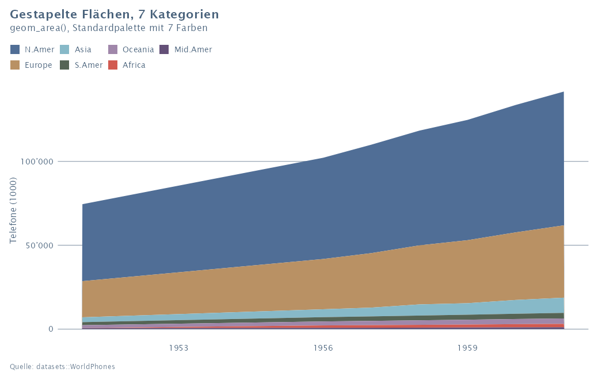

<details><summary>Code</summary>

```r
d <- as.data.frame(as.table(WorldPhones))
names(d) <- c("jahr", "region", "telefone")
d$jahr <- as.numeric(as.character(d$jahr))

ggplot(d, aes(jahr, telefone, fill = region)) +
  geom_area() +
  scale_y_continuous(labels = scales::label_number(big.mark = "’")) +
  labs(title = "Gestapelte Flächen, 7 Kategorien",
       subtitle = "geom_area(), Standardpalette mit 7 Farben",
       x = NULL, y = "Telefone (1000)", fill = NULL,
       caption = "Quelle: datasets::WorldPhones") +
  theme_bfh()
```

</details>

## Verteilungen

### Histogramm

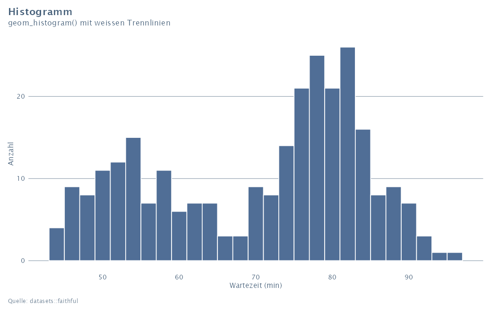

<details><summary>Code</summary>

```r
ggplot(faithful, aes(waiting)) +
  geom_histogram(binwidth = 2, colour = "white") +
  labs(title = "Histogramm",
       subtitle = "geom_histogram() mit weissen Trennlinien",
       x = "Wartezeit (min)", y = "Anzahl", caption = "Quelle: datasets::faithful") +
  theme_bfh()
```

</details>

### Dichten mit Transparenz

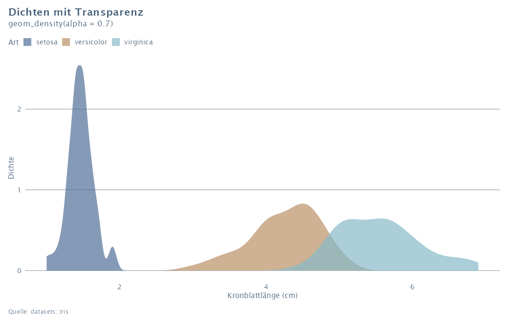

<details><summary>Code</summary>

```r
ggplot(iris, aes(Petal.Length, fill = Species)) +
  geom_density(alpha = 0.7, colour = NA) +
  labs(title = "Dichten mit Transparenz",
       subtitle = "geom_density(alpha = 0.7)",
       x = "Kronblattlänge (cm)", y = "Dichte", fill = "Art",
       caption = "Quelle: datasets::iris") +
  theme_bfh()
```

</details>

### Boxplot mit Einzelwerten

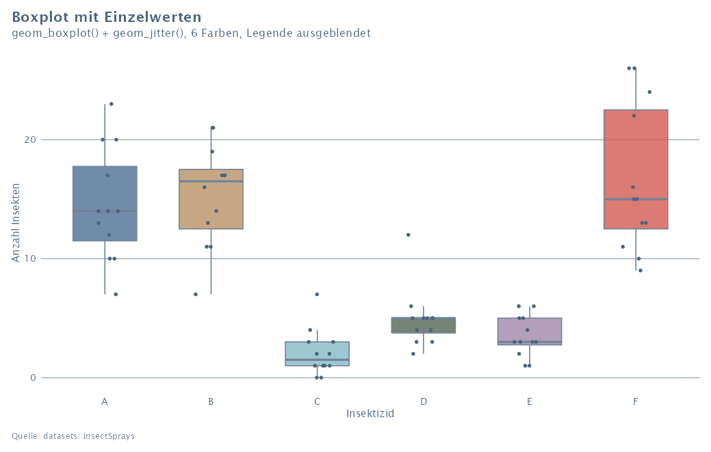

<details><summary>Code</summary>

```r
ggplot(InsectSprays, aes(spray, count, fill = spray)) +
  geom_boxplot(width = 0.6, outlier.shape = NA, alpha = 0.8) +
  geom_jitter(width = 0.15, height = 0, size = 1) +
  labs(title = "Boxplot mit Einzelwerten",
       subtitle = "geom_boxplot() + geom_jitter(), 6 Farben, Legende ausgeblendet",
       x = "Insektizid", y = "Anzahl Insekten", caption = "Quelle: datasets::InsectSprays") +
  theme_bfh(legend_position = "none")
```

</details>

### Violinplot mit Mittelwert ± Standardfehler

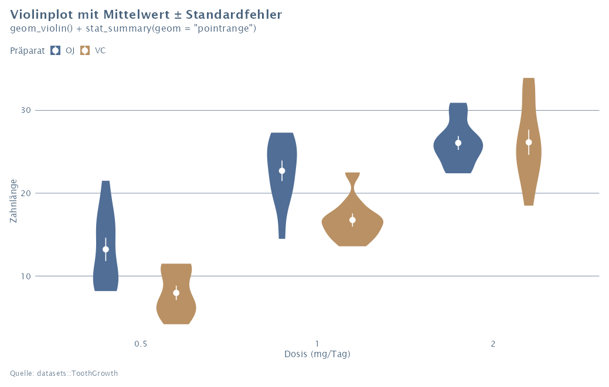

<details><summary>Code</summary>

```r
d <- transform(ToothGrowth, dose = factor(dose))

ggplot(d, aes(dose, len, fill = supp)) +
  geom_violin(position = position_dodge(0.8), width = 0.7, colour = NA) +
  stat_summary(fun.data = mean_se, geom = "pointrange", colour = "white",
               position = position_dodge(0.8)) +
  labs(title = "Violinplot mit Mittelwert ± Standardfehler",
       subtitle = "geom_violin() + stat_summary(geom = \"pointrange\")",
       x = "Dosis (mg/Tag)", y = "Zahnlänge", fill = "Präparat",
       caption = "Quelle: datasets::ToothGrowth") +
  theme_bfh()
```

</details>

### Mittelwerte mit Fehlerbalken

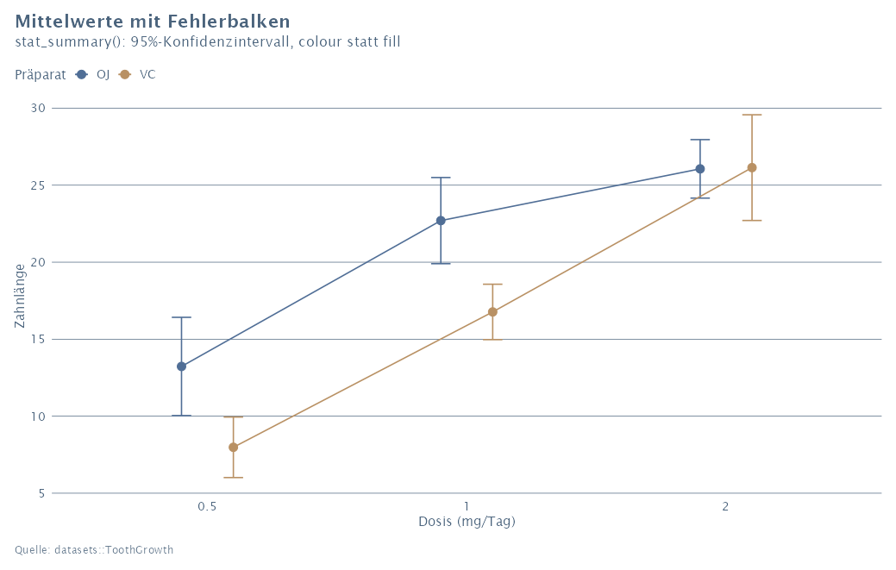

<details><summary>Code</summary>

```r
d <- transform(ToothGrowth, dose = factor(dose))

ggplot(d, aes(dose, len, colour = supp)) +
  stat_summary(fun.data = function(x) {
                 m <- mean(x); h <- qt(0.975, length(x) - 1) * sd(x) / sqrt(length(x))
                 data.frame(y = m, ymin = m - h, ymax = m + h)
               }, geom = "errorbar", width = 0.15,
               position = position_dodge(0.4)) +
  stat_summary(fun = mean, geom = "point", size = 2.5, position = position_dodge(0.4)) +
  stat_summary(fun = mean, geom = "line", aes(group = supp), position = position_dodge(0.4)) +
  labs(title = "Mittelwerte mit Fehlerbalken",
       subtitle = "stat_summary(): 95%-Konfidenzintervall, colour statt fill",
       x = "Dosis (mg/Tag)", y = "Zahnlänge", colour = "Präparat",
       caption = "Quelle: datasets::ToothGrowth") +
  theme_bfh()
```

</details>

## Streudiagramme

### Streudiagramm mit Punktbeschriftung

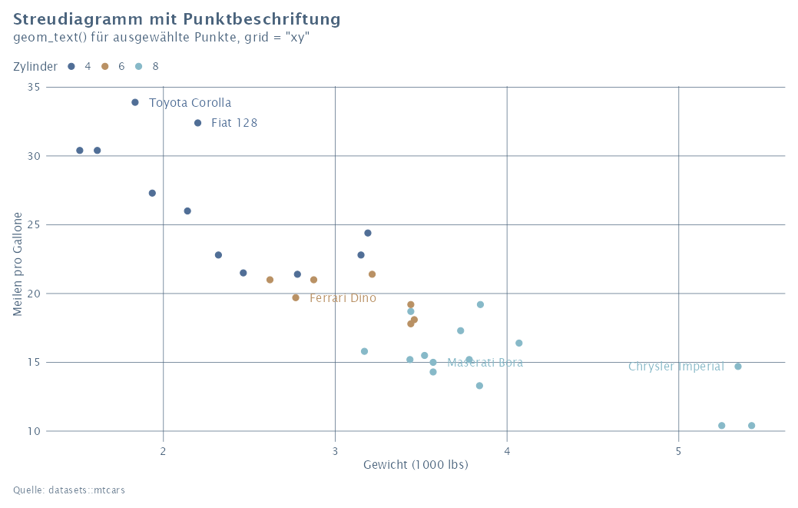

<details><summary>Code</summary>

```r
d <- transform(mtcars, auto = rownames(mtcars), cyl = factor(cyl))
lab <- d[c("Toyota Corolla", "Fiat 128", "Ferrari Dino", "Maserati Bora",
           "Chrysler Imperial"), ]
lab$hj <- ifelse(lab$wt > 5, 1, 0)

ggplot(d, aes(wt, mpg, colour = cyl)) +
  geom_point(size = 2) +
  geom_text(data = lab, aes(label = auto, hjust = hj),
            nudge_x = ifelse(lab$hj == 1, -0.08, 0.08), size = 3.2, show.legend = FALSE) +
  labs(title = "Streudiagramm mit Punktbeschriftung",
       subtitle = "geom_text() für ausgewählte Punkte, grid = \"xy\"",
       x = "Gewicht (1000 lbs)", y = "Meilen pro Gallone", colour = "Zylinder",
       caption = "Quelle: datasets::mtcars") +
  theme_bfh(grid = "xy")
```

</details>

### Kontinuierliche Farbe und Grösse

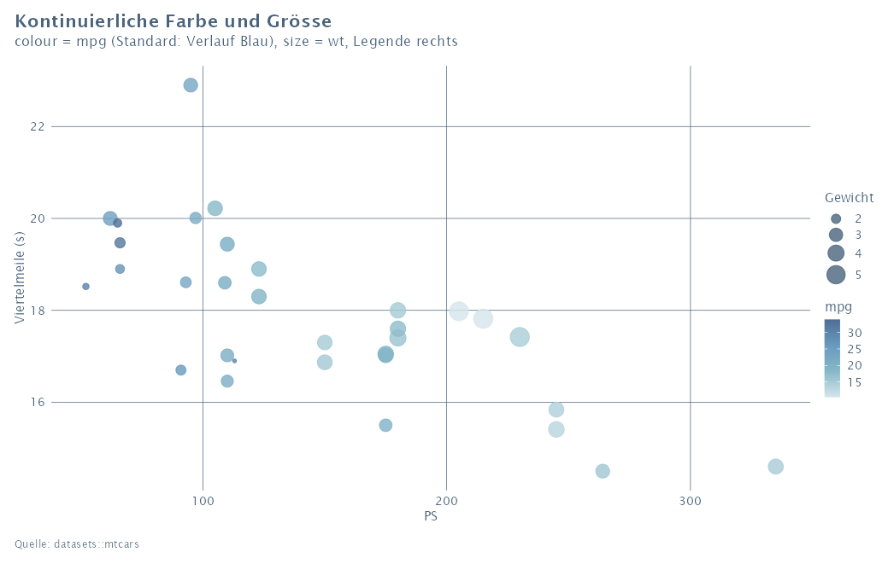

<details><summary>Code</summary>

```r
ggplot(mtcars, aes(hp, qsec, colour = mpg, size = wt)) +
  geom_point(alpha = 0.8) +
  labs(title = "Kontinuierliche Farbe und Grösse",
       subtitle = "colour = mpg (Standard: Verlauf Blau), size = wt, Legende rechts",
       x = "PS", y = "Viertelmeile (s)", colour = "mpg", size = "Gewicht",
       caption = "Quelle: datasets::mtcars") +
  theme_bfh(grid = "xy", legend_position = "right")
```

</details>

### Streudiagramm mit 2D-Dichte

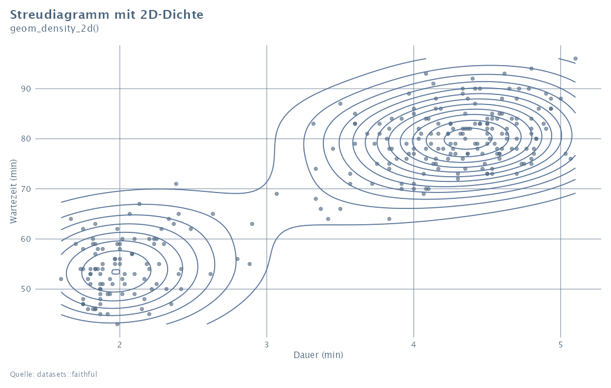

<details><summary>Code</summary>

```r
ggplot(faithful, aes(eruptions, waiting)) +
  geom_point(alpha = 0.6) +
  geom_density_2d(colour = bfh_colors[["dunkelblau"]]) +
  labs(title = "Streudiagramm mit 2D-Dichte",
       subtitle = "geom_density_2d()",
       x = "Dauer (min)", y = "Wartezeit (min)", caption = "Quelle: datasets::faithful") +
  theme_bfh(grid = "xy")
```

</details>

## Facetten

### facet_wrap() mit Regressionsgerade


<details><summary>Code</summary>

```r
ggplot(iris, aes(Sepal.Length, Petal.Length)) +
  geom_point() +
  geom_smooth(method = "lm", formula = y ~ x) +
  facet_wrap(~Species) +
  labs(title = "facet_wrap() mit Regressionsgerade",
       subtitle = "Facettentitel linksbündig und fett, geom_smooth(method = \"lm\")",
       x = "Kelchblattlänge (cm)", y = "Kronblattlänge (cm)",
       caption = "Quelle: datasets::iris") +
  theme_bfh(grid = "xy")
```

</details>

### facet_grid()

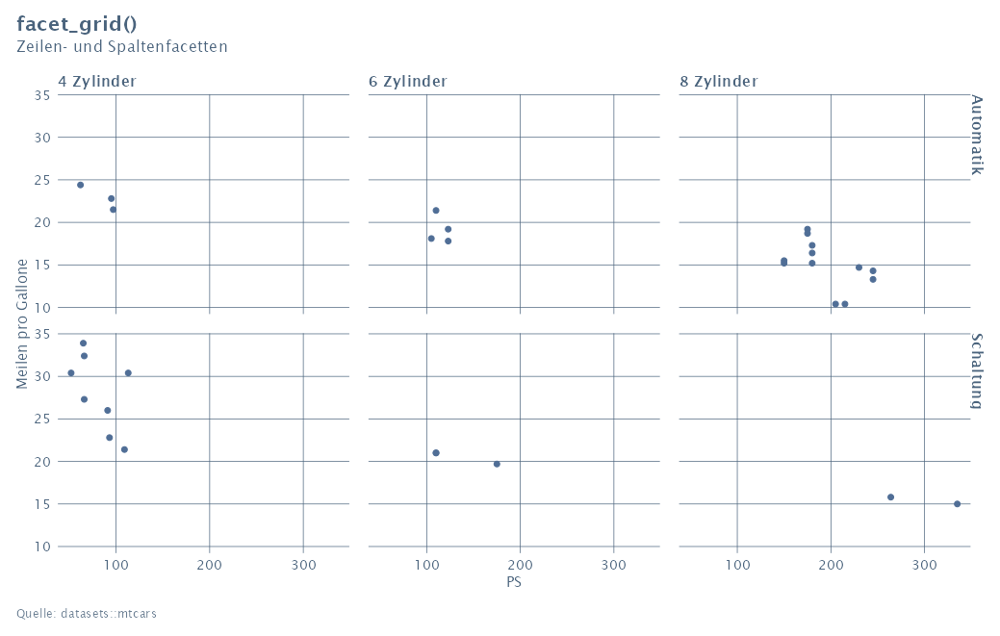

<details><summary>Code</summary>

```r
d <- transform(mtcars,
               am = factor(am, labels = c("Automatik", "Schaltung")),
               cyl = factor(cyl, labels = paste(c(4, 6, 8), "Zylinder")))

ggplot(d, aes(hp, mpg)) +
  geom_point(colour = bfh_colors[["dunkelblau"]]) +
  facet_grid(am ~ cyl) +
  labs(title = "facet_grid()",
       subtitle = "Zeilen- und Spaltenfacetten",
       x = "PS", y = "Meilen pro Gallone", caption = "Quelle: datasets::mtcars") +
  theme_bfh(grid = "xy")
```

</details>

### facet_wrap() mit freien Achsen

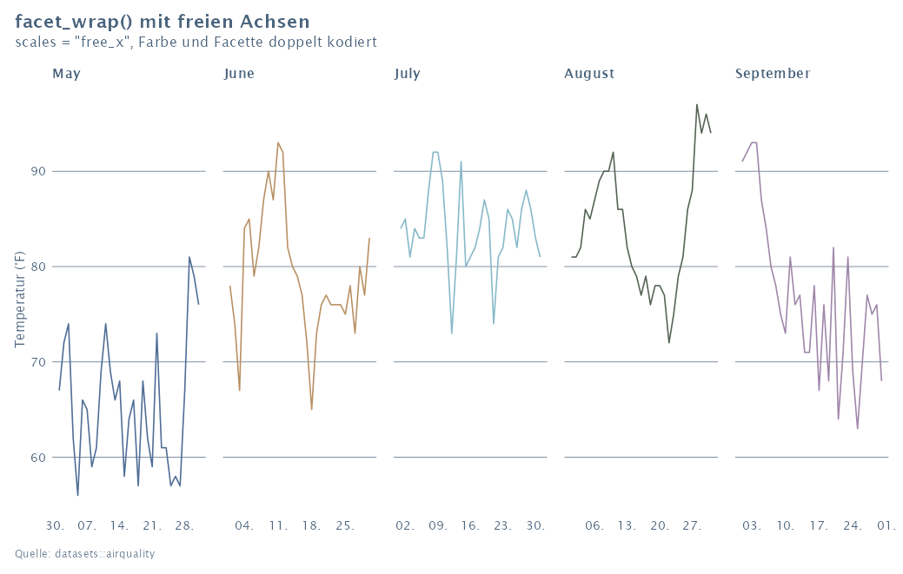

<details><summary>Code</summary>

```r
d <- transform(airquality, datum = as.Date(paste(1973, Month, Day, sep = "-")),
               monat = factor(month.name[Month], levels = month.name[5:9]))

ggplot(d, aes(datum, Temp, colour = monat)) +
  geom_line() +
  facet_wrap(~monat, nrow = 1, scales = "free_x") +
  scale_x_date(date_labels = "%d.") +
  labs(title = "facet_wrap() mit freien Achsen",
       subtitle = "scales = \"free_x\", Farbe und Facette doppelt kodiert",
       x = NULL, y = "Temperatur (°F)", caption = "Quelle: datasets::airquality") +
  theme_bfh(legend_position = "none")
```

</details>

### Facetten mit gestapelten Balken

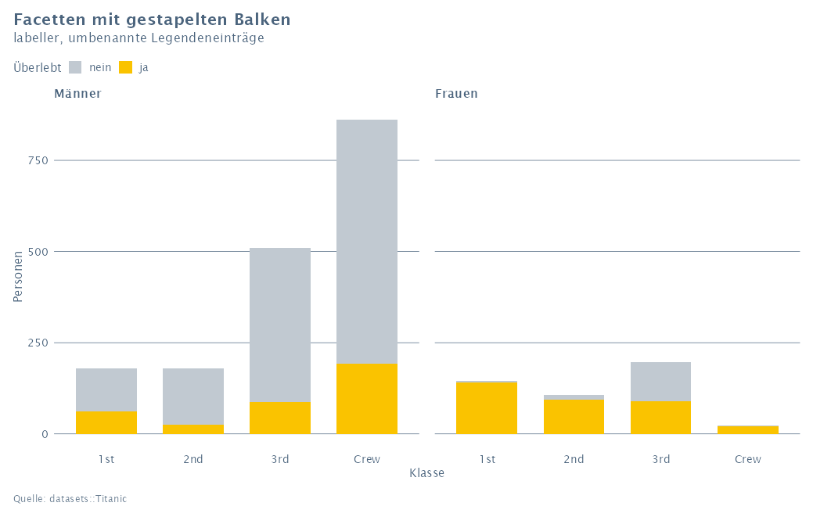

<details><summary>Code</summary>

```r
d <- as.data.frame(Titanic)
d <- aggregate(Freq ~ Class + Sex + Survived, d, sum)

ggplot(d, aes(Class, Freq, fill = Survived)) +
  geom_col(width = 0.7) +
  facet_wrap(~Sex, labeller = as_labeller(c(Male = "Männer", Female = "Frauen"))) +
  scale_fill_bfh("highlight", labels = c(No = "nein", Yes = "ja")) +
  labs(title = "Facetten mit gestapelten Balken",
       subtitle = "labeller, umbenannte Legendeneinträge",
       x = "Klasse", y = "Personen", fill = "Überlebt",
       caption = "Quelle: datasets::Titanic") +
  theme_bfh()
```

</details>

## Flächen, Heatmaps, Kreise

### Heatmap mit Höhenlinien

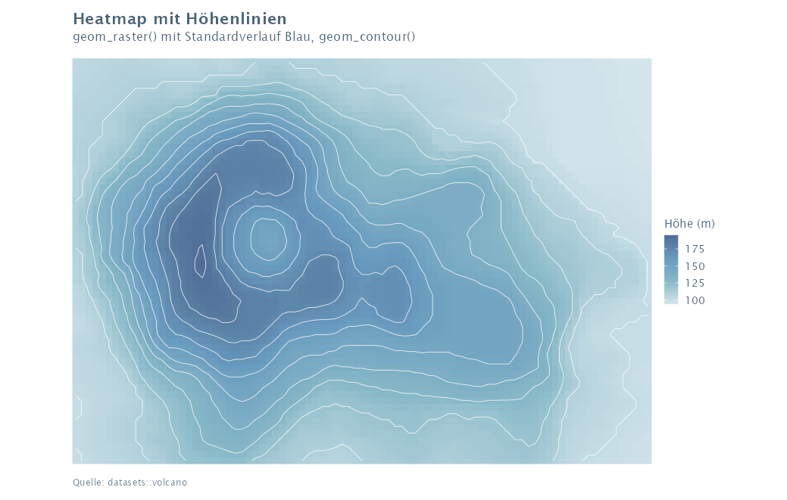

<details><summary>Code</summary>

```r
d <- data.frame(x = rep(seq_len(nrow(volcano)), ncol(volcano)),
                y = rep(seq_len(ncol(volcano)), each = nrow(volcano)),
                hoehe = as.vector(volcano))

ggplot(d, aes(x, y, fill = hoehe)) +
  geom_raster() +
  geom_contour(aes(x, y, z = hoehe), inherit.aes = FALSE,
               colour = "white", linewidth = 0.2, bins = 12) +
  coord_fixed(expand = FALSE) +
  labs(title = "Heatmap mit Höhenlinien",
       subtitle = "geom_raster() mit Standardverlauf Blau, geom_contour()",
       x = NULL, y = NULL, fill = "Höhe (m)", caption = "Quelle: datasets::volcano") +
  theme_bfh(grid = "none", legend_position = "right") +
  theme(axis.text = element_blank())
```

</details>

### Andere Verläufe

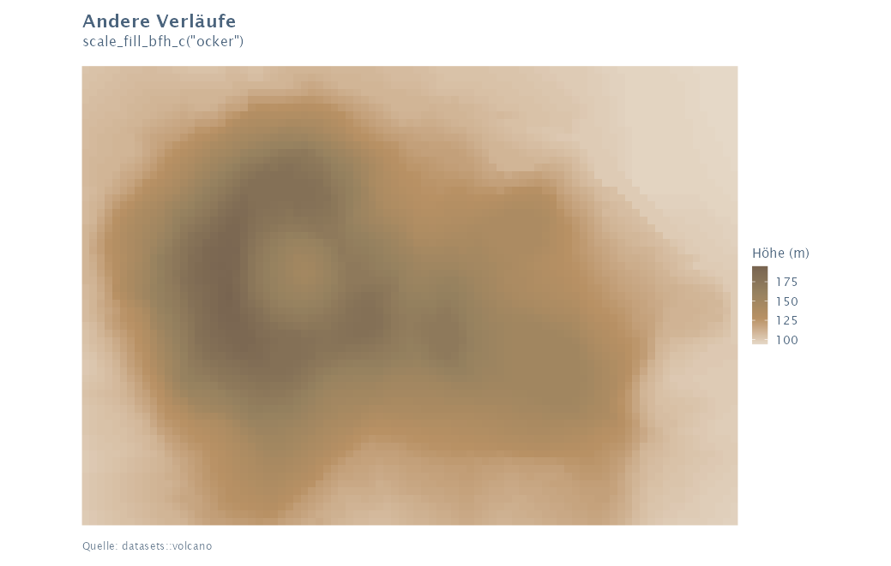

<details><summary>Code</summary>

```r
d <- data.frame(x = rep(seq_len(nrow(volcano)), ncol(volcano)),
                y = rep(seq_len(ncol(volcano)), each = nrow(volcano)),
                hoehe = as.vector(volcano))

ggplot(d, aes(x, y, fill = hoehe)) +
  geom_raster() +
  scale_fill_bfh_c("ocker") +
  coord_fixed(expand = FALSE) +
  labs(title = "Andere Verläufe",
       subtitle = "scale_fill_bfh_c(\"ocker\")",
       x = NULL, y = NULL, fill = "Höhe (m)", caption = "Quelle: datasets::volcano") +
  theme_bfh(grid = "none", legend_position = "right") +
  theme(axis.text = element_blank())
```

</details>

### Korrelationsmatrix mit Werten


<details><summary>Code</summary>

```r
cm <- cor(mtcars)
d <- data.frame(x = factor(rep(colnames(cm), each = nrow(cm)), levels = colnames(cm)),
                y = factor(rep(rownames(cm), ncol(cm)), levels = rev(rownames(cm))),
                r = as.vector(cm))

ggplot(d, aes(x, y, fill = r)) +
  geom_tile(colour = "white", linewidth = 0.5) +
  geom_text(aes(label = sprintf("%.1f", r), colour = abs(r) > 0.6), size = 3) +
  scale_fill_bfh_c("divergierend", limits = c(-1, 1)) +
  scale_colour_manual(values = c(`TRUE` = "white", `FALSE` = bfh_colors[["dunkelgrau"]]),
                      guide = "none") +
  coord_fixed() +
  labs(title = "Korrelationsmatrix mit Werten",
       subtitle = "scale_fill_bfh_c(\"divergierend\"), Textfarbe je nach Hintergrund",
       x = NULL, y = NULL, fill = "r", caption = "Quelle: datasets::mtcars") +
  theme_bfh(grid = "none", legend_position = "right")
```

</details>

### Kreisdiagramm

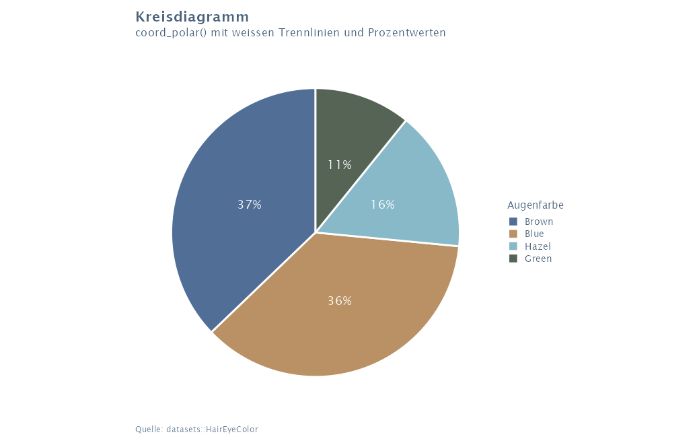

<details><summary>Code</summary>

```r
d <- aggregate(Freq ~ Eye, as.data.frame(HairEyeColor), sum)
d$anteil <- d$Freq / sum(d$Freq)

ggplot(d, aes(x = "", y = Freq, fill = Eye)) +
  geom_col(width = 1, colour = "white", linewidth = 0.8) +
  geom_text(aes(label = scales::percent(anteil, accuracy = 1)),
            position = position_stack(vjust = 0.5), colour = "white", size = 4) +
  coord_polar(theta = "y") +
  labs(title = "Kreisdiagramm",
       subtitle = "coord_polar() mit weissen Trennlinien und Prozentwerten",
       x = NULL, y = NULL, fill = "Augenfarbe",
       caption = "Quelle: datasets::HairEyeColor") +
  theme_bfh(grid = "none", legend_position = "right") +
  theme(axis.text = element_blank())
```

</details>

### Lollipop-Diagramm

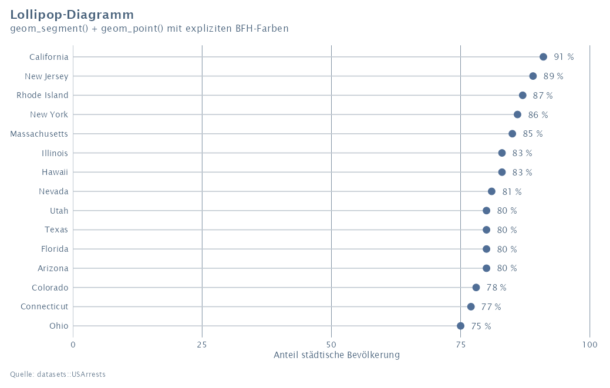

<details><summary>Code</summary>

```r
d <- head(USArrests[order(-USArrests$UrbanPop), , drop = FALSE], 15)
d$state <- rownames(d)

ggplot(d, aes(UrbanPop, reorder(state, UrbanPop))) +
  geom_segment(aes(x = 0, xend = UrbanPop), colour = bfh_colors[["grauwert3"]]) +
  geom_point(size = 3, colour = bfh_colors[["dunkelblau"]]) +
  geom_text(aes(label = paste0(UrbanPop, " %")), hjust = -0.5, size = 3.2) +
  scale_x_continuous(limits = c(0, 100), expand = expansion(mult = c(0, 0.02))) +
  labs(title = "Lollipop-Diagramm",
       subtitle = "geom_segment() + geom_point() mit expliziten BFH-Farben",
       x = "Anteil städtische Bevölkerung", y = NULL,
       caption = "Quelle: datasets::USArrests") +
  theme_bfh(grid = "x")
```

</details>

## Theme-Optionen

### Folienformat

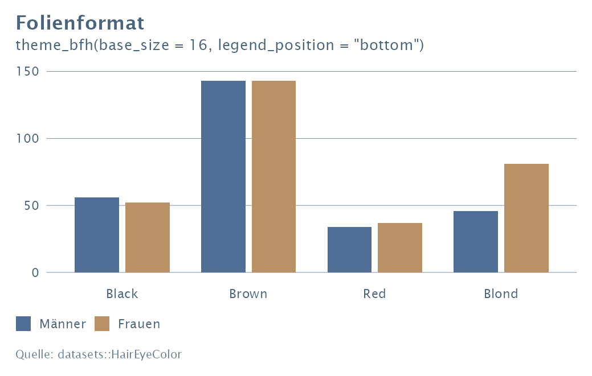

<details><summary>Code</summary>

```r
d <- aggregate(Freq ~ Hair + Sex, as.data.frame(HairEyeColor), sum)

ggplot(d, aes(Hair, Freq, fill = Sex)) +
  geom_col(position = position_dodge(width = 0.8), width = 0.7) +
  scale_fill_bfh(labels = c(Male = "Männer", Female = "Frauen")) +
  labs(title = "Folienformat",
       subtitle = "theme_bfh(base_size = 16, legend_position = \"bottom\")",
       x = NULL, y = NULL, fill = NULL, caption = "Quelle: datasets::HairEyeColor") +
  theme_bfh(base_size = 16, legend_position = "bottom")
```

</details>

### Ohne Gitterlinien, Legende rechts

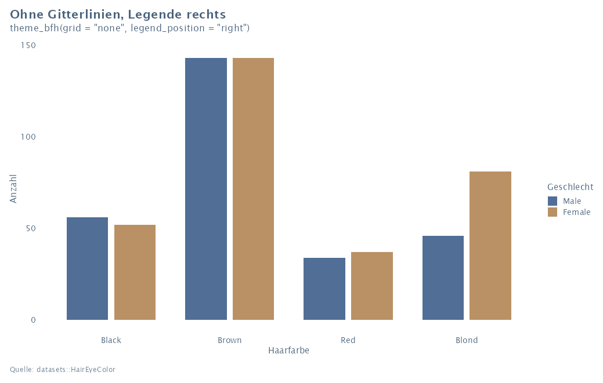

<details><summary>Code</summary>

```r
d <- aggregate(Freq ~ Hair + Sex, as.data.frame(HairEyeColor), sum)

ggplot(d, aes(Hair, Freq, fill = Sex)) +
  geom_col(position = position_dodge(width = 0.8), width = 0.7) +
  labs(title = "Ohne Gitterlinien, Legende rechts",
       subtitle = "theme_bfh(grid = \"none\", legend_position = \"right\")",
       x = "Haarfarbe", y = "Anzahl", fill = "Geschlecht",
       caption = "Quelle: datasets::HairEyeColor") +
  theme_bfh(grid = "none", legend_position = "right")
```

</details>

### BFH-Farbpaletten

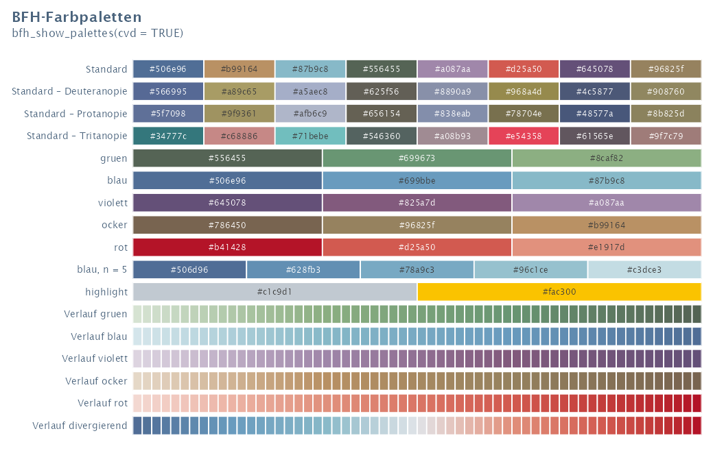

<details><summary>Code</summary>

```r
bfh_show_palettes(cvd = TRUE) +
  labs(subtitle = "bfh_show_palettes(cvd = TRUE)")
```

</details>
