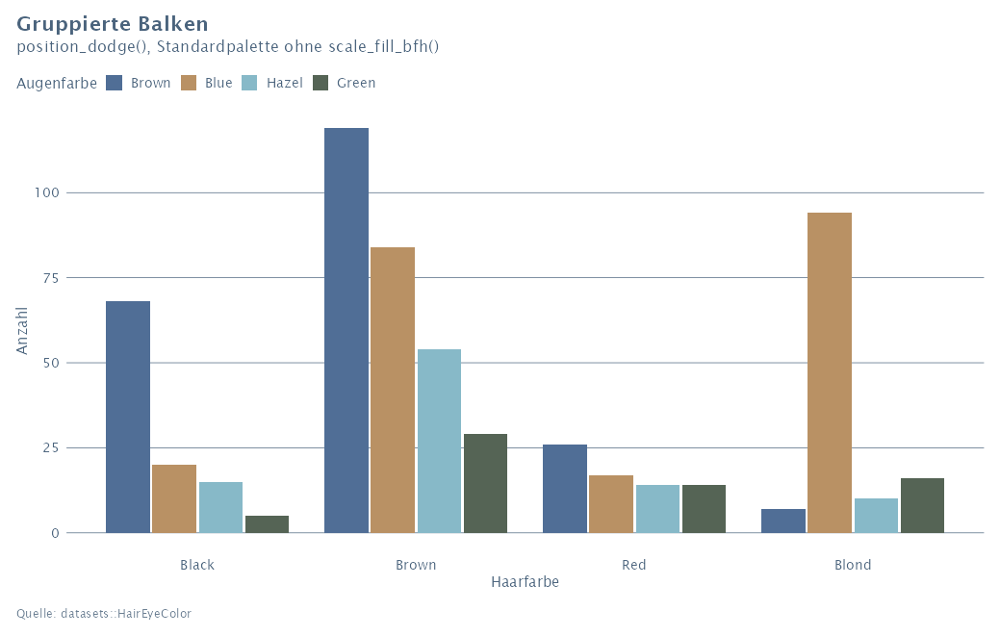
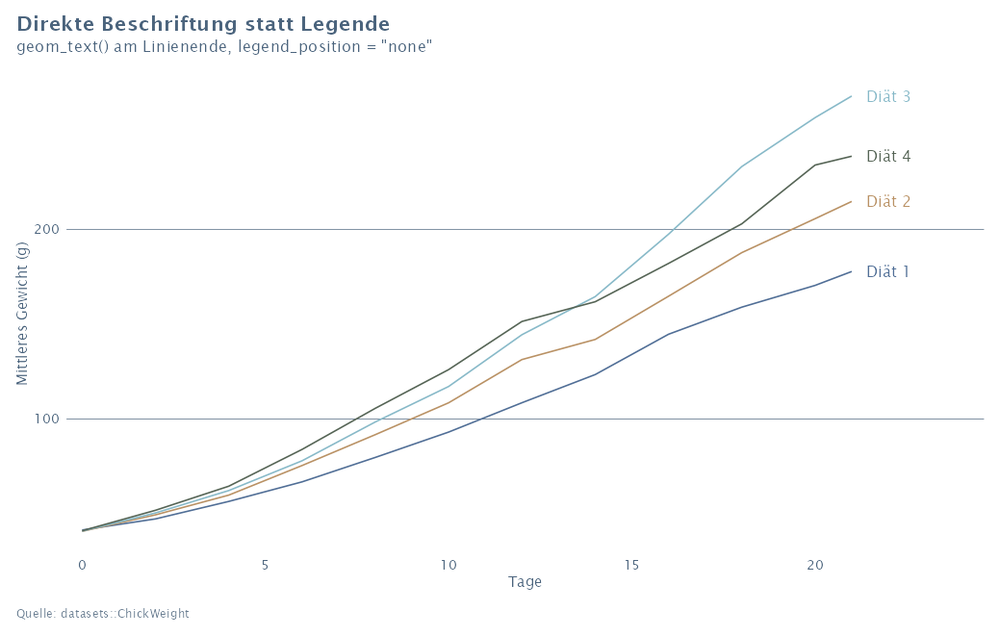
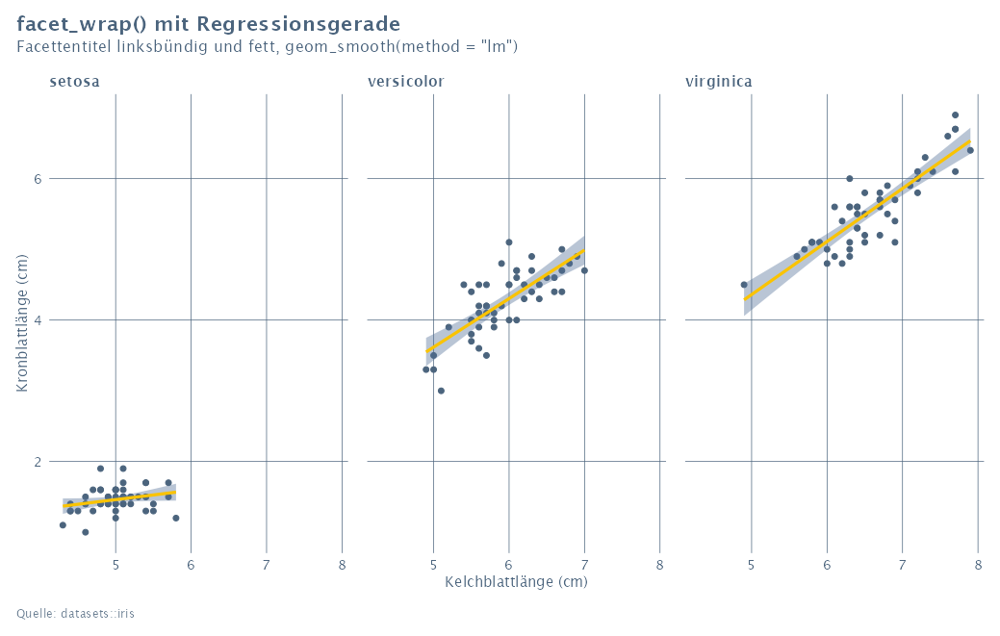
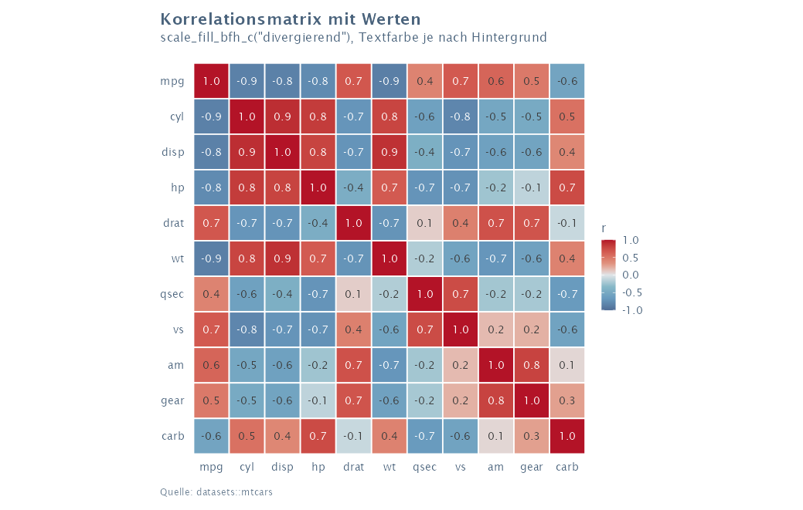

# ggbfh

ggplot2-Theme und Farbpaletten im Stil der BFH. Die Farbwerte stammen aus dem
BFH-Markenmanual, als Schrift wird Lucida Sans verwendet.

## Installation

```r
install.packages("remotes")
remotes::install_github("ordeldoi/ggbfh")
install.packages("ragg")   # für die Schrift
```

Aktualisieren geht mit demselben Befehl. Benötigt R ≥ 4.1 und ggplot2 ≥ 4.0
(wird bei Bedarf mitinstalliert). Damit Lucida Sans korrekt erscheint, in
RStudio unter *Tools › Global Options › General › Graphics* das Backend auf
**AGG** stellen.

## Verwendung

```r
library(ggplot2)
library(ggbfh)

ggplot(mtcars, aes(wt, mpg, colour = factor(cyl))) +
  geom_point() +
  labs(title = "Verbrauch nach Gewicht", caption = "Quelle: datasets::mtcars") +
  theme_bfh()

bfh_save("grafik.png", width = 16, height = 10)   # cm
```

`theme_bfh()` setzt die BFH-Standardpalette bereits als Vorgabe. Eine
`scale_*_bfh()` braucht es nur für andere Paletten.

## Beispiele

<table>
<tr>
<td></td>
<td></td>
</tr>
<tr>
<td></td>
<td></td>
</tr>
</table>

**[Alle 32 Beispiele mit Code ansehen › GALERIE.md](GALERIE.md)**

## Funktionen

| Funktion | Zweck |
|---|---|
| `theme_bfh(base_size, grid, legend_position)` | Theme. `grid = "y"/"x"/"xy"/"none"` |
| `scale_fill_bfh()` / `scale_colour_bfh()` | diskret: `"standard"`, `"gruen"`, `"blau"`, `"violett"`, `"ocker"`, `"rot"`, `"highlight"` |
| `scale_fill_bfh_c()` / `scale_colour_bfh_c()` | kontinuierlich: Familien oder `"divergierend"` |
| `bfh_colors` | alle Farben als benannter Vektor, z.B. `bfh_colors["dunkelblau"]` |
| `bfh_pal()`, `bfh_gradient()`, `bfh_tints()` | Farbvektoren für eigene Zwecke |
| `bfh_show_palettes(cvd = TRUE)` | Übersicht aller Paletten, optional mit Simulation von Farbsehschwächen |
| `bfh_save()` | Export (PNG/JPEG/TIFF mit ragg, PDF mit Cairo), Masse in cm |

## Hinweise

- Die Standardpalette hat 8 Farben, ist aber nur bis ca. 5 Kategorien auch bei
  Farbsehschwächen gut unterscheidbar. Bei mehr Kategorien besser direkt
  beschriften oder gruppieren.
- Farbfamilien (`"blau"` usw.) werden bei mehr als 3 Kategorien automatisch
  über einen Verlauf bis zu einer aufgehellten Farbe erweitert.
- `"highlight"` passt zu einer logischen Variable: `FALSE` grau, `TRUE` orange.
- Geordnete Faktoren (`ordered`) erhalten beim Laden des Pakets die
  Farbfamilie Blau als Standard (über die Optionen `ggplot2.ordinal.colour`
  und `ggplot2.ordinal.fill`, sofern diese nicht schon gesetzt sind).
- Linienstärken und Punktgrössen entsprechen dem ggplot2-Standard.
- Das Standard-PDF-Gerät `pdf()` kann Lucida Sans nicht verwenden und weicht
  auf Helvetica aus. In R Markdown / Quarto daher `dev = "ragg_png"` als
  Chunk-Option setzen; für PDF-Dateien `bfh_save("datei.pdf")` verwenden.

## Entwicklung

Die Hilfeseiten (`man/`) und der `NAMESPACE` werden mit roxygen2 aus den
Kommentaren in `R/` erzeugt. Nach Änderungen:

```r
roxygen2::roxygenise()
```

Danach neu installieren (`R CMD INSTALL .`). Die Beispielgrafiken stehen in
`dev/gallery_plots.R`. `dev/gallery_md.R` erzeugt daraus `GALERIE.md` mit den
Bildern in `galerie/`, `dev/gallery_pdf.R` dieselben Grafiken als PDF
(`output/ggbfh_galerie.pdf`).

## Lizenz

Die Nutzung ist Angehörigen der BFH vorbehalten; mit dem Paket erstellte
Grafiken dürfen frei verwendet werden. Details in [LICENSE](LICENSE). Das Paket
ist kein offizielles Produkt der BFH.
